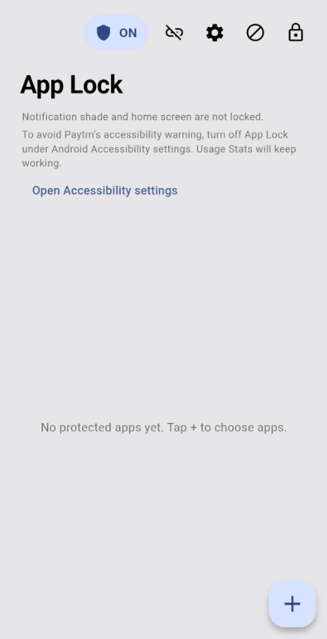
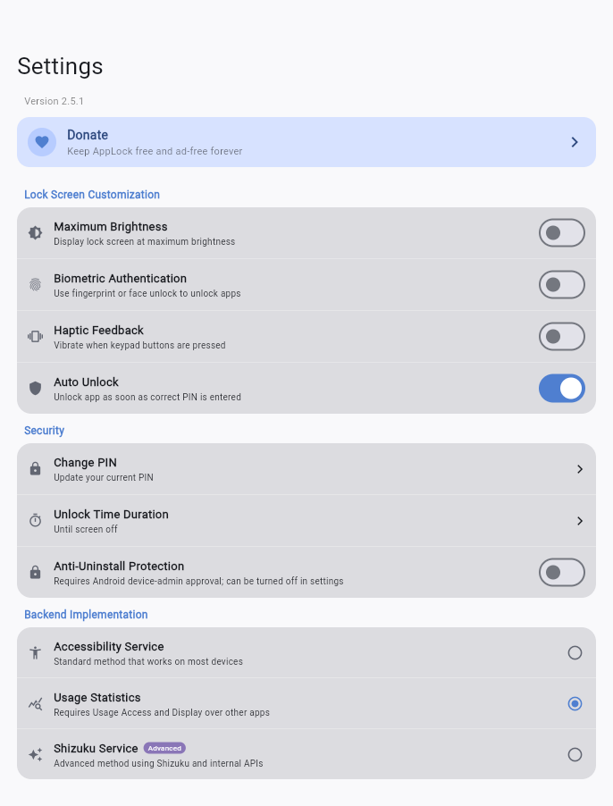
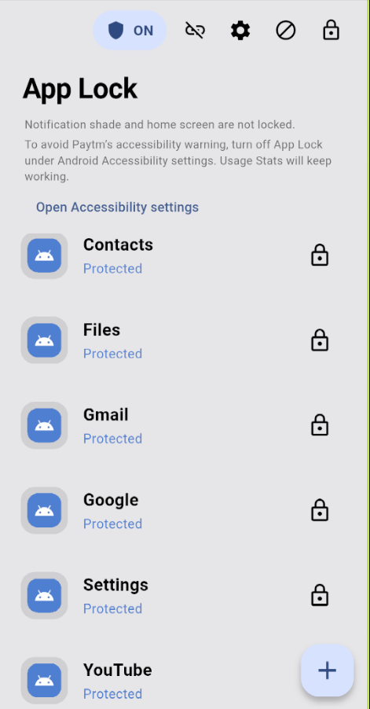

# 🔐 App Lock – Flutter Application

## 📱 Project Overview
App Lock is a Flutter-based Android application that allows users to protect selected installed apps using PIN-based authentication and configurable security settings.

## ✨ Features
- Lock and Unlock Selected Apps.
- Custom 4-Digit PIN Protection.
- Individual & Combined App Unlocking.
- Protected & Excluded Apps Management.
- Configurable Unlock Duration.
- Biometric Authentication Setting.
- Anti-Uninstall Protection.
- Haptic Feedback & Auto Unlock Settings.
- Multiple Lock Backends: Accessibility Service, Usage Statistics & Shizuku.
- Clean Material 3 UI.

## 🛠️ Tech Stack
- **Framework:** Flutter
- **Language:** Dart
- **Platform:** Android
- **Native Integration:** Kotlin / Android Platform Channels
- **UI:** Material 3
- **Tools:** VS Code, Android Studio, Git & GitHub

## 📂 Folder Structure
```text
app_lock/
├── android/
│   └── app/
│       └── src/main/
│           ├── kotlin/
│           └── AndroidManifest.xml
├── lib/
│   ├── models/
│   │   └── app_lock_models.dart
│   ├── screens/
│   │   ├── app_lock_screen.dart
│   │   └── settings_screen.dart
│   ├── theme/
│   │   └── app_lock_theme.dart
│   ├── widgets/
│   │   └── app_lock_widgets.dart
│   └── main.dart
├── test/
├── pubspec.yaml
└── README.md
```

## 📸 Screenshots

| Home Screen | Settings |
|---|---|
|  |  |

| PIN Screen | Protected Apps |
|---|---|
|  |  |

## 🚀 Installation Steps

1. Clone the repository:
```bash
git clone https://github.com/bhupender1208/App_Lock.git
```

2. Navigate to the project:
```bash
cd app_lock
```

3. Install dependencies:
```bash
flutter pub get
```

4. Connect your Android device and grant the required permissions.

5. Run the application:
```bash
flutter run
```

## 👨‍💻 Author

**Bhupender**

- GitHub: [@bhupender1208](https://github.com/bhupender1208)
- LinkedIn: [Bhupender](https://www.linkedin.com/in/bhupender-00b134282/)
